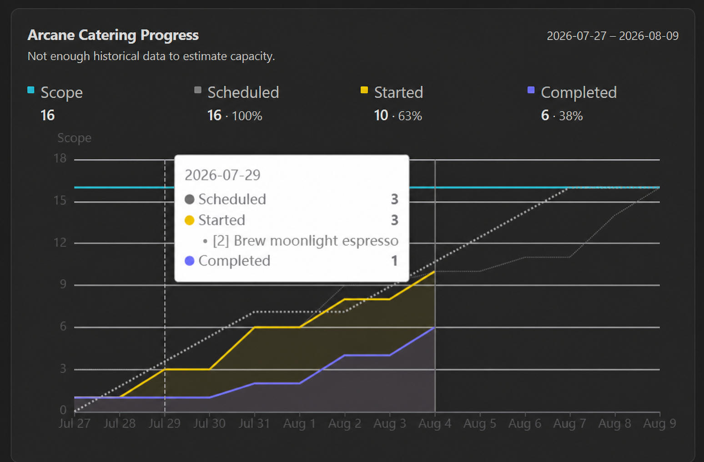

# TaskNotes Views

TaskNotes Views adds Project management progress charts to [TaskNotes](https://github.com/callumalpass/tasknotes) project notes in Obsidian.



## Features

- Automatically embeds a progress widget in TaskNotes project notes in both reading view and Live Preview.
- Supports duration estimates such as `timeEstimate` and unitless estimates such as story points.
- Shows cumulative scope, scheduled, started, completed, and ideal target progress.
- Pauses ideal progress on weekends by default, with an option to count weekends.
- Shows scheduled, started, and completed task names in the hover popup, including each task's scope.
- Optionally estimates project capacity from recent historical velocity.
- Estimates virtual and materialized recurring TaskNotes occurrences.

## Requirements

- Obsidian 1.13 or newer.
- The TaskNotes plugin, with its version 1 public API available.
- Notes recognized as projects by TaskNotes. TaskNotes Views uses TaskNotes' project relationship index when available and falls back to its configured project tag or property markers.

## How project progress is calculated

The reporting time span comes from the configured project start and end frontmatter properties (defaults `scheduled` and `due`):

```yaml
---
scheduled: 2026-07-27
due: 2026-08-09
---
```

When **Derive date range from tasks** is enabled, a missing start falls back to the earliest configured scheduled or started date among project tasks, and a missing end falls back to the latest task due date.

### Chart values

- **Scope** is the sum of the estimated work for every included work item in the project.
- **Scheduled** accumulates scope on each task's configured scheduled date.
- **Started** accumulates scope based on a configurable start date property. (Use the "Stamp started timestamp" workflow from the [TaskNotes Workflows](https://github.com/callumalpass/tasknotes-workflows) plugin to automatically set a start date when a task is set to in-progress.)
- **Completed** accumulates scope on the task's completion date.
- **Target** distributes total scope evenly across the reporting window. By default it advances on weekdays and remains flat on weekends.

TaskNotes statuses configured as skipped are excluded from scope, scheduled, started, and completed values.

The hover popup omits Scope and Target because they do not represent task events on a particular day. Scheduled, Started, and Completed entries include matching task names with scope prefixes, such as `[45m] Polish the silverware` or `[2] Brew moonlight espresso`.

## Recurring tasks

Each recurrence is treated as a logical work item:

- Virtual recurring parents are projected into the reporting window from their recurrence rule.
- `complete_instances` and `skipped_instances` provide completion and skip history for non-materialized occurrences.
- A completed virtual occurrence uses the recurring template's estimate.
- A matching materialized occurrence overrides the projection with its own project assignment, estimate, status, scheduled date, started date, and completion state.
- A materialized occurrence moved to another project is excluded from the original project's calculations.
- The parent template is not counted as an additional unit of scope.
- Materialized completions are not counted again from the parent's compatibility history.

Virtual occurrences cannot expose an independent started date. They remain unstarted until completed. Materialized occurrences can contribute started work through their configured started property.

## Capacity estimation

Enable **Estimate capacity from past velocity** to compare planned scope with an estimated capacity. Estimated capacity appears in the **Scope** heading for the progress graph, for example:

```text
Scope / Capacity
9 / 10 (90%)
```

Capacity is calculated from completed task scope during the six weeks before the project starts:

1. Completed work is grouped into six weekly buckets.
2. The oldest through newest buckets receive linear weights from 1 through 6.
3. Project capacity is computed from the weighted weekly velocity scaled to the number of working days in the project date range.

An estimate requires at least three completed scoped work items spanning at least three weeks. If history is insufficient, the widget retains the normal **Scope** metric and displays a notice that not enough historical data exists to estimate capacity.

## Settings

| Setting | Default | Purpose |
| --- | --- | --- |
| Project start property | `scheduled` | Project frontmatter property containing the reporting start date. |
| Project end property | `due` | Project frontmatter property containing the reporting end date. |
| Derive date range from tasks | Off | Fills missing project boundaries from task dates. |
| Scope property | `timeEstimate` | Task property containing duration, points, or another numeric scope value. |
| Scope is a duration | On | Formats scope as minutes and hours instead of a unitless number. |
| Estimate capacity from past velocity | Off | Compares planned scope with recency-weighted historical capacity. |
| Task started property | `startedAt` | Task property recording when work actually began. |
| Task scheduled property | `scheduled` | Task property recording when work is planned to begin. |
| In-progress statuses | `in-progress` | Comma-separated status values that count as started. TaskNotes-completed statuses are always included. |
| Count weekends | Off | Allows ideal target progress and capacity scaling to count Saturdays and Sundays. |

## Installation

Install from the Obsidian community plugin catalog and enable **TaskNotes Views** under **Settings → Community plugins**.

## Development

Install dependencies and start the watch build:

```bash
npm install
npm run dev
```

Available validation and packaging commands:

```bash
npm run typecheck
npm test
npm run lint
npm run build
npm run copy-files
npm run build:test
```

`npm run copy-files` copies `main.js`, `manifest.json`, and `styles.css` to destinations listed in `.copy-files.local`, the `OBSIDIAN_PLUGIN_PATH` environment variable, or the default TaskNotes end-to-end test vault.

### Releases

Add user-facing changes to `docs/releases/unreleased.md`, then prepare a release with npm's version command:

```bash
npm version patch
git push --follow-tags
```

Use `minor`, `major`, or an explicit semantic version instead of `patch` when appropriate. The version lifecycle synchronizes `manifest.json` and `versions.json`, promotes the unreleased notes to `docs/releases/<version>.md`, regenerates the release index, commits the changes, and creates the version tag. Pushing the tag triggers GitHub Actions, which builds the plugin and creates a draft GitHub release using that Markdown file. Review and publish the draft in GitHub.

`npm run version` only invokes the lifecycle script directly and does not create npm's version commit or Git tag; use `npm version ...` for releases.

## License

[MIT](LICENSE)
